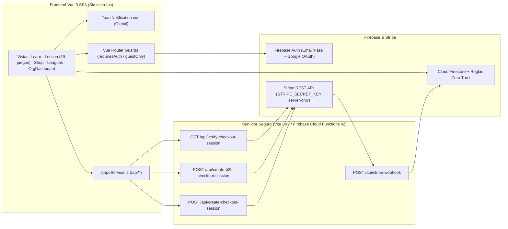

# 🛡️ SuriLearn — Plataforma Gamificada de Ciberseguridad (B2C + PYMES B2B)

> **Versión Actual:** `v0.16.0` (Pre-1.0 · 15 Cursos Secuenciales × 5 Lecciones, Diagnóstico de 10 Preguntas, Mapa Limpio y Podios Firestore)  
> **Propuesta de Valor:** *Una plataforma de aprendizaje de ciberseguridad gamificada que transforma la capacitación tradicional en una experiencia interactiva, progresiva y personalizada, dirigida tanto a usuarios individuales como a organizaciones que buscan fortalecer las competencias de seguridad de sus empleados.*

---

## 📌 Visión General del Ecosistema

**SuriLearn** sustituye los cursos corporativos pasivos (PDFs extensos, charlas anuales con lenguaje técnico) por cápsulas gamificadas diarias de **3 a 5 minutos** guiadas por **Suri, el Centinela Suricato**, integrando los marcos **Octalysis**, **Modelo Conductual de Fogg**, **NIST SP 800-63B**, **NIST SP 800-61** y **OWASP Top 10**.

Este monorepo reúne los **3 pilares completos del proyecto**:

| Carpeta | Contenido | Tecnología / Entregables |
|---|---|---|
| [`app/`](./app/) | **Aplicación Web Progresiva PWA (`v0.16.0`)** | Vue 3, TypeScript (`strict: true`), Pinia, Tailwind CSS (WCAG 2.1 AA), Chart.js, Vitest (`20/20`), Firebase Auth/Firestore, Stripe Checkout + Cloud Functions v2 |
| [`promo-video/`](./promo-video/) | **Video Promocional Animado (1080p @ 30fps)** | Remotion (`4.0.539`), React 19, Tailwind CSS v4, escenas actualizadas a `v0.12.0` + renders `.mp4` / `.png` |
| [`docs-negocio/`](./docs-negocio/) | **Emprendimiento, Validación y Modelado** | Business Model Canvas, Estudio Estadístico ($n=50$), Análisis Financiero, Buyer Personas, Mapa de Empatía, Diagramas UML/BPMN/ER y Mockups HD |

---

## 🏗️ Arquitectura del Sistema



---

## 🎮 Currículo Secuencial de 15 Cursos (75 Lecciones) y 19 Motores Interactivos

La plataforma incluye **15 cursos secuenciales (`75 lecciones` + `15 cofres` = `90` nodos)** ordenados de fácil a maestro con un **Sistema Teórico Dual** (**Códice del Curso** en `UnitTheoryModal.vue` + **Briefing Pre-Misión** en `LessonTheoryBriefing.vue`) y **19 motores de juego desacoplados**:

### Escalera Progresiva de 15 Cursos (5 Lecciones por Curso)
- **Nivel 1 · Principiante (`Cursos 1–3`)**: Vocabulario base (Ahorcado, Sopa de Letras, Memorama), Phishing e Ingeniería Social, Contraseñas NIST, MFA y Permisos Móviles.
- **Nivel 2 · Explorador (`Cursos 4–6`)**: Reflejos Arcade contra Malware (Culebrita, Topos, Breakout, Buscaminas, Invasores), Defensa Perimetral y Bastión Firewall, Redes Seguras y Laberinto VPN.
- **Nivel 3 · Intermedio (`Cursos 7–9`)**: Fraude BEC y Deepfakes IA, Respuesta a Incidentes SOC y Ransomware (protocolo NIST), Seguridad Cloud / SaaS y Prevención DLP.
- **Nivel 4 · Avanzado (`Cursos 10–12`)**: OWASP Top 10 (Inyecciones SQL, XSS, IDOR), Zero Trust y Blindaje de APIs (SSRF/JWT), Forense Digital y Threat Hunting en RAM.
- **Nivel 5 · Maestro (`Cursos 13–15`)**: Defensa APT y Cadena de Suministro, Gobierno CISO / ISO 27001 / Continuidad y Desafío Maestro Centinela integrado.

### 19 Motores de Minijuegos y Videojuegos (`app/src/components/games/`)
- **6 Minijuegos Core**: `InboxThreatScanner`, `UrlInspector`, `PasswordVaultBuilder`, `SocialEngineeringChat`, `PermissionGatekeeper`, `RapidTriageRadar`.
- **5 Videojuegos Avanzados (Paleta SuriLearn `v0.14.0`)**: `FirewallDefenseGame` (3 carriles a `60fps` con bonus de puntería), `NetworkMazeGame` (Madriguera 2.5D con rastro y swipe), `IncidentCommandGame` (consola SOC), `CodePatcherGame` (hotfix DevSecOps) y `ForensicInvestigatorGame` (laboratorio CSI en RAM).
- **4 Juegos Clásicos Arcade (`v0.13.0`)**: `CyberHangmanGame` (Ahorcado Ciberdefensor), `CyberSnakeGame` (Culebrita Firewall), `CyberMemoryGame` (Memorama de Pares) y `ThreatWhackGame` (Atrapa al Hacker en puertos).
- **4 Juegos Clásicos Zona Arcade Pro (`v0.14.0`)**: `CyberWordSearchGame` (Sopa de Letras), `CyberMinesweeperGame` (Buscaminas de Malware), `CyberBreakoutGame` (Rompe-Malware Canvas `60fps`) y `CyberInvadersGame` (Invasores del Spam Canvas `60fps`).

---

## ⚙️ Funcionalidades Principales

- 🎯 **Diagnóstico Inicial de 10 Preguntas y Progresión Secuencial (`v0.16.0`)**: Evaluación progresiva automática tras registrarse (`DiagnosticModal.vue`, `/tabs/learn?diagnostic=1`) que ubica al usuario en el curso acorde a su nivel (`Cursos 1, 4, 7, 10 o 13`), acredita los módulos previos para repaso y mantiene bloqueo secuencial hacia adelante, junto con **Centro de Errores** real (`/lesson/error-review`) y selector editable de Meta Diaria (`3 / 5 / 10 min`).
- ❤️ **Gamificación y Economía**: 5 vidas con regeneración pasiva cada 4h, **Modo Refuerzo** a 0 vidas, aprobación mínima (`≥60%`) con `1–3` estrellas persistentes, cofres atómicos (`runTransaction`), rachas diarias con multiplicadores `x1.0`–`x2.0` y consumo real de *Congelador de Racha*, boosts `2X XP` persistidos, medallas dinámicas, notificaciones `ToastNotification.vue` y **Dark Sentinel WCAG 2.1 AA**.
- 🏆 **Ligas Pobladas en 5 Divisiones en Tiempo Real (`v0.16.0`)**: Ranking global real en Firestore con cuentas activas en todos los podios (`Bronce → Plata → Oro → Diamante → Supremo`, `29` usuarios en `/users`), pestañas de exploración por división en `LeaderboardView.vue`, cuenta regresiva semanal real y **Liga Privada Empresarial** sincronizados con `onSnapshot`.
- 🏢 **Panel Corporativo PYME (B2B + RBAC)**: Creación de organizaciones (`micro_pyme` 10, `growth_pyme` 30, `enterprise` 100), código transaccional (`runTransaction`), aislamiento RBAC entre Administradores CISO y Colaboradores, analítica semanal real (`activeDates`) + **Exportar CSV**, detección `"En Riesgo"` y suspensión preventiva en tiempo real (`onSnapshot`).
- 📱 **PWA, Mapa Limpio y Calidad (`v0.16.0`)**: Instalable (`manifest.webmanifest` + Service Worker `sw.js`), ruta continua estilo Duolingo con los **15 cursos (`75` lecciones) en una sola página** sin selector superior de saltos, camino curvo SVG dinámico (`CourseWindingPath.vue` + `pathGeometry.ts`), lazy-loading de rutas (`64.35 kB` de entrada), mascota **Suri reactiva con 11 poses** (`SuriMascotAnimated.vue`), paleta oficial en los 19 motores, manejo global de errores y **20 pruebas unitarias Vitest** automatizadas.
- 🔒 **Endurecimiento P0 (`v0.11.0`)**: Autenticación dual (**Email/Contraseña** + **Google OAuth**), guards `requiresAuth` / `guestOnly`, reglas **Zero Trust** en [`app/firestore.rules`](./app/firestore.rules), y secrets/verificación de Stripe exclusivamente server-side (`vite.config.ts` / [`app/functions/`](./app/functions/)).

---

## 🚀 Guía Rápida de Ejecución

### 1. Aplicación Web (`app/`)
```bash
cd app
npm install
cp .env.example .env   # Configura tus claves Firebase y STRIPE_SECRET_KEY (sin prefijo VITE_)
npm run dev            # Levanta la app + endpoints locales de Stripe en http://localhost:3000
```
Pruebas, verificación estricta de tipos y compilación PWA:
```bash
npm test
node ./node_modules/vue-tsc/bin/vue-tsc.js --noEmit
npm run build
```

### 2. Cloud Functions de Producción (`app/functions/`)
```bash
cd app/functions
npm install
npm run build
```
*(Despliegue en Firebase requiere Plan Blaze: `firebase deploy --only functions,hosting,firestore:rules,firestore:indexes`)*

### 3. Video Promocional (`promo-video/`)
```bash
cd promo-video
npm install
npm run dev            # Abre Remotion Studio
```

---

## 🗺️ Mapa del Repositorio

```text
SuriLearn/
├── README.md                  # Documentación principal del ecosistema SuriLearn
├── CHANGELOG.md               # Historial cronológico de versiones (v0.1.0 -> v0.16.0)
├── .gitignore                 # Exclusiones de secretos (.env), node_modules, dist y temporales
├── app/                       # PWA Vue 3 + TypeScript + Vitest + Firebase + Stripe + Cloud Functions
│   ├── README.md              # Documentación técnica de la aplicación
│   ├── docs/                  # SRS, Informe Técnico, Design System y Planes v0.1.0 - v0.16.0
│   ├── functions/             # Cloud Functions v2 para Stripe B2C/B2B y Webhooks
│   ├── prototypes/            # Prototipos HTML/PNG de Stitch UI
│   ├── src/                   # Código fuente (vistas, minijuegos, stores, composables)
│   └── Suri/                  # Poses oficiales de la mascota Suri
├── promo-video/               # Proyecto Remotion del video promocional + renderizado MP4
└── docs-negocio/              # Canvas, Validación (n=50), Análisis Financiero, Diagramas SVG y Mockups
```

---

## 📚 Documentación Detallada

- 📘 **[Documento de Ingeniería de Software y Gestión TI (SRS, Arquitectura y Algoritmos)](./app/docs/DOCUMENTO_PROYECTO_TI_SURILEARN.md)**
- 📙 **[Informe Técnico y Marco Teórico](./app/docs/INFORME_TECNICO_Y_MARCO_TEORICO.md)**
- 🎨 **[Sistema de Diseño "Suri Sentinel" 2.5D](./app/docs/DESIGN_SURI_SENTINEL.md)**
- 📋 **[Índice de Planes por Versión (`docs/plans/`)](./app/docs/plans/README.md)**
- 💼 **[Artefactos de Negocio, Diagramas y Mockups (`docs-negocio/`)](./docs-negocio/README.md)**
- 🎬 **[Video Promocional (`promo-video/`)](./promo-video/README.md)**

---

## 🧭 Siguientes Fases Planeadas (Hacia `v1.0.0`)
- **Cloud Functions en Producción (Plan Blaze)** y webhook firmado con `STRIPE_WEBHOOK_SECRET` en Firebase.
- **Certificados PDF/QR verificables**, asignación de módulos obligatorios por departamento e integración IA Gemini en servidor.
- **Re-renderizado de video Remotion (`promo-video/`)** para actualizar el archivo `.mp4` con las escenas de `v0.12.0`.
