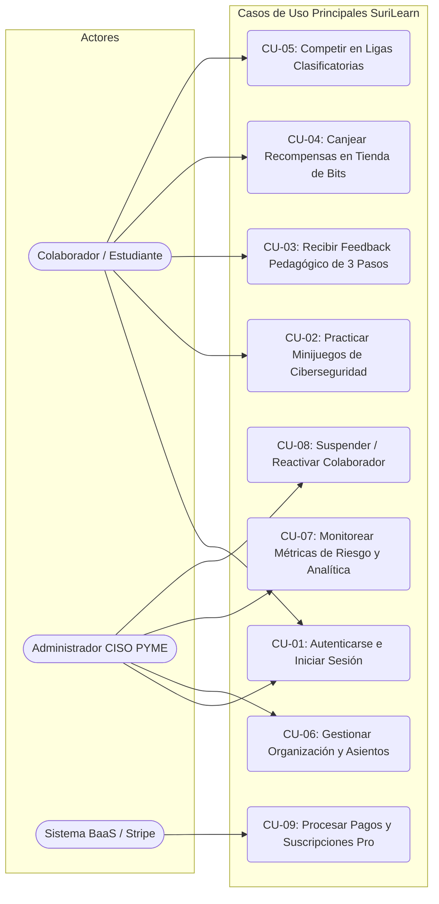
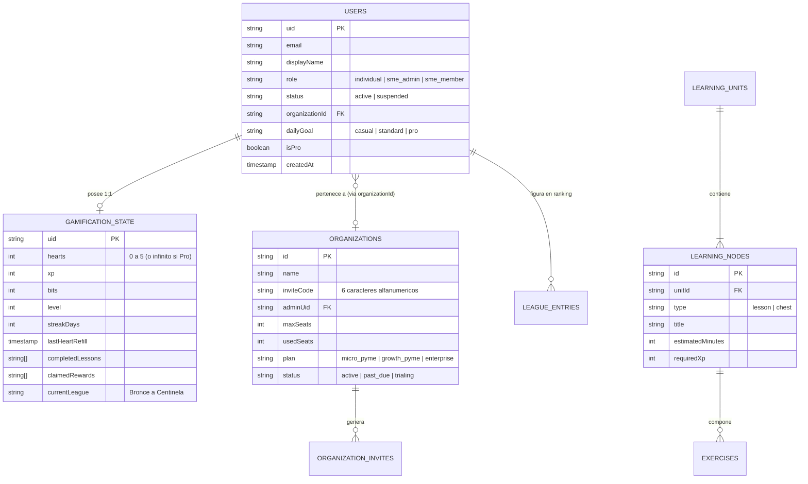
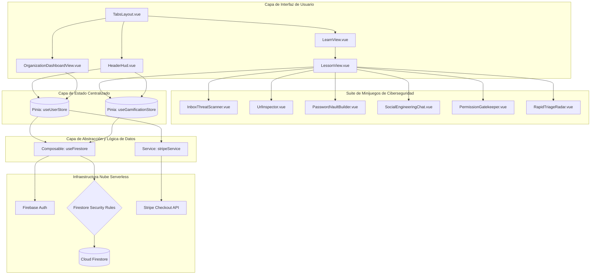

# DOCUMENTO DE INGENIERÍA DE SOFTWARE Y GESTIÓN DE PROYECTO TI
# PROYECTO: SuriLearn — Plataforma Gamificada de Concientización en Ciberseguridad para PYMES

**Versión del Documento:** 1.0.0  
**Fecha:** Octubre de 2026  
**Tipo de Documento:** Especificación Integral de Requerimientos, Análisis, Diseño, Implementación, Pruebas y Mantenimiento de Software (IEEE 830 / ISO/IEC/IEEE 29148 / XP Standard)  
**Equipo de Desarrollo:** Equipo Dual (2 Integrantes)  
**Metodología Ágil:** Extreme Programming (XP) con Programación en Pareja (*Pair Programming*) y Principios de *Crystal Clear*  
**Estado del Software:** Release Candidate 1.0.0 Operativo (SPA/PWA con Backend-as-a-Service)

---

## ÍNDICE GENERAL

1. [INTRODUCCIÓN Y GENERALIDADES DEL PROYECTO](#1-introducción-y-generalidades-del-proyecto)
   - 1.1 Contexto y Declaración del Problema en Ciberseguridad PYME
   - 1.2 Misión y Visión de SuriLearn
   - 1.3 Metáfora del Sistema y Filosofía de Gamificación
2. [METODOLOGÍA DE DESARROLLO DE SOFTWARE PARA 2 PERSONAS: EXTREME PROGRAMMING (XP) & CRYSTAL CLEAR](#2-metodología-de-desarrollo-de-software-para-2-personas-extreme-programming-xp--crystal-clear)
   - 2.1 Justificación Técnica de la Metodología para un Equipo de 2 Desarrolladores
   - 2.2 Roles Dinámicos: Pair Programming (Conductor / Navegador)
   - 2.3 Prácticas y Valores XP Adaptados
   - 2.4 Flujo de Trabajo en Git y Gestión de Entregas (CI/CD Ligero)
   - 2.5 Comunicación Osmótica y Ceremonias Adaptadas
3. [ESPECIFICACIÓN DE REQUERIMIENTOS DE SOFTWARE (SRS)](#3-especificación-de-requerimientos-de-software-srs)
   - 3.1 Requerimientos Funcionales (RF-01 al RF-18)
   - 3.2 Requerimientos No Funcionales (RNF-01 al RNF-12)
   - 3.3 Matriz de Reglas de Negocio (RN-01 a RN-08)
4. [ANÁLISIS DEL SISTEMA](#4-análisis-del-sistema)
   - 4.1 Historias de Usuario (HU-01 a HU-10) con Criterios de Aceptación Gherkin
   - 4.2 Actores del Sistema y Diagrama de Casos de Uso
   - 4.3 Modelo de Dominio y Diagrama Entidad-Relación NoSQL (Firestore Collections)
5. [DISEÑO DEL SISTEMA Y ARQUITECTURA DE SOFTWARE](#5-diseño-del-sistema-y-arquitectura-de-software)
   - 5.1 Arquitectura Lógica de 4 Capas Desacopladas
   - 5.2 Diagrama de Componentes del Sistema
   - 5.3 Sistema de Diseño UI/UX "Suri Sentinel" y Estilo Táctil 2.5D
   - 5.4 Agente Pedagógico Suri: Sistema de 8 Poses y Feedback de 3 Pasos
   - 5.5 Arquitectura de los 6 Minijuegos Educativos
6. [IMPLEMENTACIÓN Y PROGRAMACIÓN](#6-implementación-y-programación)
   - 6.1 Ficha Técnica Exhaustiva del Stack Tecnológico
   - 6.2 Estructura y Organización del Código Fuente
   - 6.3 Algoritmos Críticos Desarrollados (con Fórmulas y Código)
     - 6.3.1 Algoritmo de Regeneración Pasiva de Vidas (Intervalos de 4h)
     - 6.3.2 Algoritmo de Entropía y Crackeo de Contraseñas (NIST SP 800-63B)
     - 6.3.3 Algoritmo Transaccional Anti-Exploit para Reclamación de Cofres (ACID)
     - 6.3.4 Algoritmo de Detección de Colaboradores en Riesgo (PYME Analytics)
     - 6.3.5 Algoritmo de Racha y Multiplicadores Progresivos
7. [PLAN Y MATRIZ DE PRUEBAS DE SOFTWARE (TESTING & QA)](#7-plan-y-matriz-de-pruebas-de-software-testing--qa)
   - 7.1 Estrategia de Pruebas para un Equipo de 2 Personas (Pair Testing)
   - 7.2 Matriz de Casos de Prueba (CP-01 a CP-10)
   - 7.3 Pruebas de Seguridad y Validación de Reglas Zero Trust en Firestore
   - 7.4 Pruebas de Usabilidad, Responsive y Rendimiento Lighthouse
8. [DESPLIEGUE, OPERACIÓN Y MANTENIMIENTO](#8-despliegue-operación-y-mantenimiento)
   - 8.1 Estrategia de Despliegue Continuo (CI/CD con Firebase Hosting)
   - 8.2 Planes de Mantenimiento de Software (Correctivo, Perfectivo, Adaptativo, Preventivo)
   - 8.3 Monitoreo de Telemetría, Logs y Respaldo de Datos
9. [CRONOGRAMA DE SPRINTS / ITERACIONES DEL EQUIPO DUAL](#9-cronograma-de-sprints--iteraciones-del-equipo-dual)
10. [CONCLUSIONES Y LECCIONES APRENDIDAS](#10-conclusiones-y-lecciones-aprendidas)

---

# 1. INTRODUCCIÓN Y GENERALIDADES DEL PROYECTO

### 1.1 Contexto y Declaración del Problema en Ciberseguridad PYME
En el panorama tecnológico contemporáneo, más del 82% de las brechas de seguridad confirmadas en pequeñas y medianas empresas (PYMES) involucran el factor humano: interacción con correos de *phishing*, credenciales vulnerables o reutilizadas, ingeniería social vía mensajería instantánea y descarga de ejecutables fraudulentos.

A pesar de la gravedad de estas amenazas, las PYMES enfrentan dos grandes barreras:
1. **Presupuestos limitados**: No pueden adquirir costosas licencias corporativas tipo KnowBe4 o Proofpoint que cobran miles de dólares anuales por empleado.
2. **Capacitaciones obsoletas y aburridas**: Los cursos tradicionales de ciberseguridad se basan en videos lineales y cuestionarios teóricos de una sola vez al año, generando una retención conceptual nula y el rechazo de los colaboradores.

**SuriLearn** nace como la respuesta técnica y pedagógica: una plataforma de concientización continua y gamificada (inspirada en la experiencia de usuario adictiva y gratificante de Duolingo), pero adaptada al dominio estricto de la ciberseguridad defensiva para colaboradores de PYMES y usuarios individuales.

### 1.2 Misión y Visión de SuriLearn
- **Misión**: Empoderar a los colaboradores de PYMES mediante micro-entrenamientos gamificados diarios de 3 a 5 minutos, transformándolos de ser "el eslabón más débil" de la empresa al primer "centinela defensivo" de su organización digital.
- **Visión**: Convertirse en el estándar líder en Hispanoamérica de entrenamiento en seguridad digital interactivo, combinando microaprendizaje, modelos de comportamiento seguro y una arquitectura en la nube de costo cero en su infraestructura base.

### 1.3 Metáfora del Sistema y Filosofía de Gamificación
En Extreme Programming, la **Metáfora del Sistema** es una guía conceptual compartida que define cómo funciona la solución. En SuriLearn, la metáfora es:
> **"La Madriguera Digital y el Centinela Suri"**

El usuario asume el rol de un **Centinela** encargado de proteger la madriguera digital de su organización. La mascota del sistema es **Suri**, un suricato centinela vigilante. En la naturaleza, los suricatos son famosos por su sistema de vigilancia colectiva comunitaria donde un centinela alerta a toda la manada ante depredadores. Suri guía al usuario a través del árbol de aprendizaje, celebra los aciertos, advierte empáticamente ante engaños y duerme cuando el usuario agota sus energías (vidas).

---

# 2. METODOLOGÍA DE DESARROLLO DE SOFTWARE PARA 2 PERSONAS: EXTREME PROGRAMMING (XP) & CRYSTAL CLEAR

```
┌────────────────────────────────────────────────────────────────────────┐
│                   METODOLOGÍA DUAL XP + CRYSTAL CLEAR                  │
├──────────────────────────────────┬─────────────────────────────────────┤
│  INTEGRANTE 1 (Driver / Lead UI) │  INTEGRANTE 2 (Navigator / Data)    │
│  • Conducción de UI/UX Vue 3     │  • Navegación, QA y Casos Borde     │
│  • Gamificación y Minijuegos     │  • BaaS Firestore, Stores y Stripe  │
│  • Estilos 2.5D y Tailwind       │  • Reglas de Seguridad Zero Trust   │
├──────────────────────────────────┴─────────────────────────────────────┤
│                    PRÁCTICAS COLECTIVAS (ROTATIVAS)                    │
│   [Pair Programming] ── [Small Releases] ── [Continuous Integration]   │
│   [Planning Game]    ── [Osmotic Comm]   ── [Collective Ownership]     │
└────────────────────────────────────────────────────────────────────────┘
```

### 2.1 Justificación Técnica de la Metodología para un Equipo de 2 Desarrolladores
Al ser un equipo integrado estrictamente por **dos (2) ingenieros/desarrolladores**, las metodologías pesadas tradicionales (como RUP o Cascada) o incluso los marcos ágiles pensados para escuadras de 6 a 10 personas (como Scrum formal con sus múltiples roles: Scrum Master, Product Owner, Development Team) generan una burocracia innecesaria de reuniones, estimaciones excesivas y sobrecostos de coordinación.

Por esta razón se seleccionó **Extreme Programming (XP)** (Kent Beck) complementada con los postulados de **Crystal Clear** (Alistair Cockburn):

1. **XP es el estándar de oro para el trabajo en pareja**: Su núcleo operativo es **Pair Programming**, donde dos desarrolladores colaboran en una misma estación o código en tiempo real, aumentando la calidad del código en un 40% y reduciendo defectos sin ralentizar la entrega global.
2. **Crystal Clear está diseñada específicamente para equipos de 1 a 6 integrantes**: Prioriza la **Comunicación Osmótica** (flujo de información espontáneo y continuo entre los dos ingenieros), la **Seguridad Personal**, las **Entregas Frecuentes** (*Frequent Delivery*) al usuario final y la **Mejora Reflexiva** (*Reflective Improvement*).
3. **Propiedad Colectiva del Código (*Collective Code Ownership*)**: Ninguno de los dos integrantes es dueño exclusivo de un módulo. Ambos conocen y pueden modificar tanto el frontend reactivo como la capa de datos de Firestore.

### 2.2 Roles Dinámicos: Pair Programming (Conductor / Navegador)
Los roles no son estáticos; se alternan dinámicamente mediante la técnica de rotación de parejas por sesión o por historia de usuario:

| Rol XP | Responsabilidades Principales en SuriLearn | Integrante A | Integrante B |
|---|---|---|---|
| **Conductor (*Driver*)** | Escribe el código en el editor, implementa los SFCs de Vue, define las clases CSS táctiles, estructura las props y emits de los componentes. | Asume el teclado en Minijuegos y Vistas | Asume el teclado en Stores, BaaS y Servicios |
| **Navegador (*Navigator*)** | Revisa la sintaxis en tiempo real, analiza posibles casos de borde (exploits, race conditions, offline state), consulta la documentación oficial y redacta las pruebas. | Supervisa la consistencia de tipos y contratos en `useFirestore` | Supervisa accesibilidad, UX y reactividad de Pinia en componentes |
| **Product Owner Compartido** | Valida el cumplimiento pedagógico de las lecciones, los requerimientos del marco teórico (NIST, Octalysis) y el diseño visual de Suri. | Representa al usuario corporativo (CISO PYME) | Representa al usuario estudiante (Colaborador) |

### 2.3 Prácticas y Valores XP Adaptados
1. **Planning Game (Juego de la Planificación)**: Al inicio de cada ciclo de 2 semanas, ambos desarrolladores convierten las necesidades del proyecto en historias de usuario estimadas en puntos relativos (1, 2, 3, 5, 8).
2. **Entregas Pequeñas (*Small Releases*)**: Despliegue de versiones incrementales utilizables cada 7 a 14 días en Firebase Hosting.
3. **Diseño Simple (*Simple Design*)**: Se implementa únicamente lo requerido por la historia de usuario en curso, evitando sobre-ingeniería (*You Aren't Gonna Need It - YAGNI*).
4. **Refactorización Continua (*Refactoring*)**: Limpieza y optimización periódica de código sin alterar el comportamiento observable (ej. centralización del motor de caché TTL en `useFirestore.ts`).
5. **Estándares de Código y Tipado Estricto**: Adopción de TypeScript 5.4 en modo estricto (`strict: true`) y ESLint/vue-tsc para garantizar que ningún commit rompa contratos de tipos.

### 2.4 Flujo de Trabajo en Git y Gestión de Entregas (CI/CD Ligero)
Para 2 personas, un flujo GitFlow pesado resulta contraproducente. Se implementó una variante de **Trunk-Based Development con Ramas Cortas**:
- Rama `main`: Código en producción, siempre estable, desplegado automáticamente en Firebase Hosting.
- Ramas cortas `feat/<nombre-historia>` o `fix/<nombre-bug>`: Duración máxima de 24 a 48 horas.
- Pull Requests revisados en conjunto: Antes del merge a `main`, el integrante que fungió como Navegador aprueba el código tras ejecutar la verificación estática (`npm run type-check && npm run build`).

### 2.5 Comunicación Osmótica y Ceremonias Adaptadas
- **Daily Standup Relámpago (5 minutos)**: Charla diaria al iniciar la jornada: ¿Qué completamos ayer? ¿En qué historia trabajamos hoy en pareja? ¿Existe algún bloqueo técnico o de diseño?
- **Retrospectiva de Iteración (15 minutos)**: Al cierre de cada iteración, se discute qué funcionó bien y qué ajuste de proceso se introduce para el siguiente sprint.

---

# 3. ESPECIFICACIÓN DE REQUERIMIENTOS DE SOFTWARE (SRS)

## 3.1 Requerimientos Funcionales (RF)

| ID | Nombre del Requerimiento | Descripción Detallada | Prioridad (MoSCoW) | Módulo / Archivo Asociado |
|---|---|---|---|---|
| **RF-01** | Autenticación Dual | El sistema debe permitir el inicio de sesión y registro de usuarios mediante Email/Contraseña y mediante Proveedor OAuth 2.0 de Google. | Must Have | `LoginView.vue`, `useUserStore.ts` |
| **RF-02** | Onboarding y Meta Diaria | Durante el registro, el sistema debe permitir seleccionar el objetivo de práctica diaria: Casual (3 min/día), Constante (5 min/día) o Pro (10 min/día). | Must Have | `RegisterOnboardingView.vue` |
| **RF-03** | Árbol de Aprendizaje Progresivo | Debe renderizar un mapa de nodos secuenciales en zigzag donde cada nodo representa una lección o cofre; los nodos futuros permanecen bloqueados hasta superar el anterior. | Must Have | `LearnView.vue`, `curriculum.ts` |
| **RF-04** | Runtime de Minijuegos | La plataforma debe cargar dinámicamente el minijuego pedagógico correspondiente al tipo de ejercicio asignado a la lección activa. | Must Have | `LessonView.vue`, `components/games/*` |
| **RF-05** | Simulador de Phishing de Correos | Debe simular un cliente de correo con inspección de cabeceras SPF/DKIM, vista previa de URLs en hover y análisis de adjuntos maliciosos (.pdf.exe). | Must Have | `InboxThreatScanner.vue` |
| **RF-06** | Inspector de Estructura de URLs | Debe descomponer una URL en bloques seleccionables (protocolo, subdominio, dominio, ruta) para que el usuario identifique typosquatting o fraude. | Must Have | `UrlInspector.vue` |
| **RF-07** | Bóveda de Contraseñas y Entropía | Debe permitir ensamblar frases de paso con tokens de diferente complejidad, calculando la entropía en bits y los años estimados de crackeo en tiempo real. | Must Have | `PasswordVaultBuilder.vue` |
| **RF-08** | Simulador de Chat de Ingeniería Social | Debe recrear una conversación estilo WhatsApp donde un atacante aplica presión psicológica (urgencia/miedo); debe incluir un Botón de Pánico. | Must Have | `SocialEngineeringChat.vue` |
| **RF-09** | Auditor de Permisos Móviles | Debe presentar solicitudes de permisos de apps con gestos táctiles de arrastre (*swipe* izquierda para denegar, derecha para autorizar). | Must Have | `PermissionGatekeeper.vue` |
| **RF-10** | Radar de Triaje Rápido | Debe presentar flashcards de incidentes de seguridad contrarreloj con un temporizador circular SVG de 7 segundos por tarjeta. | Should Have | `RapidTriageRadar.vue` |
| **RF-11** | Retroalimentación de 3 Pasos | Al cometer un error, debe desplegarse un modal guiado por Suri con 3 secciones: Empatía con el engaño, Indicador técnico objetivo y Consejo preventivo. | Must Have | `SuriFeedbackModal.vue` |
| **RF-12** | Sistema de Vidas (Hearts) | El usuario cuenta con 5 vidas. Cada fallo descuenta 1 vida. Si llega a 0, se bloquea el avance regular y se habilita el Modo Refuerzo sin costo. | Must Have | `useGamificationStore.ts` |
| **RF-13** | Regeneración Pasiva y Refuerzo | Las vidas se regeneran pasivamente (1 vida cada 4 horas). Si el usuario supera una lección de refuerzo con 100% de precisión, recupera 1 vida de inmediato. | Must Have | `useFirestore.ts`, `useGamificationStore.ts` |
| **RF-14** | Economía de Bits y Tienda Virtual | El usuario gana Bits al completar lecciones y cofres, pudiendo canjearlos en la tienda por Congeladores de Racha, Recargas de Vidas o Boosters de XP. | Must Have | `ShopView.vue`, `useGamificationStore.ts` |
| **RF-15** | Racha Diaria y Multiplicadores | Debe contabilizar días consecutivos de entrenamiento, aplicando multiplicadores de XP escalonados (x1.0 a x2.0) según la categoría de racha alcanzada. | Should Have | `useGamificationStore.ts` |
| **RF-16** | Tabla de Clasificación en Tiempo Real | Debe listar el ranking de usuarios por liga competitiva (Bronce a Centinela) con sincronización reactiva en tiempo real ante cambios de puntaje. | Should Have | `LeaderboardView.vue`, `useFirestore.ts` |
| **RF-17** | Gestión Multi-Tenant para PYMES | Un administrador PYME debe poder crear una organización corporativa, generar códigos de invitación de 6 caracteres y gestionar cupos/asientos. | Must Have | `OrganizationDashboardView.vue` |
| **RF-18** | Dashboard Analítico Corporativo | El administrador PYME debe visualizar KPIs de salud digital, colaboradores en riesgo (<60% precisión) y gráficos Chart.js de resiliencia y actividad. | Must Have | `AdminAnalytics.vue` |

---

## 3.2 Requerimientos No Funcionales (RNF)

| ID | Categoría | Requerimiento No Funcional | Métrica / Criterio de Medición |
|---|---|---|---|
| **RNF-01** | Rendimiento | Tiempo de carga inicial de la SPA (First Contentful Paint). | FCP < 1.5 segundos en conexiones 4G estándar. |
| **RNF-02** | Rendimiento | Tiempo de respuesta en transiciones de lección y render de minijuegos. | Latencia de UI < 100 ms (60 FPS estables). |
| **RNF-03** | Seguridad | Arquitectura de Seguridad Declarativa Zero Trust en el acceso a datos. | 100% de las operaciones validadas en Firestore Security Rules evaluando autenticación y propiedad de UID. |
| **RNF-04** | Seguridad | Protección contra ataques de manipulación y fraude en recompensas (*anti-exploit*). | Reclamación de cofres ejecutada mediante transacciones atómicas `runTransaction()` con verificación previa de id. |
| **RNF-05** | Disponibilidad y Offline | Capacidad de funcionamiento en condiciones de conectividad degradada o nula. | Triple fallback: Firestore -> localStorage -> Seed data hardcodeada en memoria. |
| **RNF-06** | Usabilidad | Diseño centrado en el usuario con retroalimentación háptica y affordance visual. | Botones y tarjetas con sistema táctil 2.5D (deformación de 3px en clic) y micro-animaciones CSS fluidas. |
| **RNF-07** | Accesibilidad | Cumplimiento de estándares de accesibilidad visual y contraste. | Nivel WCAG 2.1 AA en paletas Light y Dark Sentinel (ratio de contraste texto-fondo superior a 7:1). |
| **RNF-08** | Compatibilidad | Soporte multiplataforma y diseño adaptativo (*Mobile-First*). | Visualización y funcionalidad óptima en resoluciones desde 360px (móviles con notch) hasta pantallas de escritorio 4K. |
| **RNF-09** | Mantenibilidad | Cobertura de tipado estricto en contratos de datos y componentes. | 100% del código en TypeScript estricto; cero warnings de compilación en `vue-tsc`. |
| **RNF-10** | Escalabilidad | Capacidad para absorber incrementos de tráfico sin gestión de infraestructura. | Arquitectura 100% Serverless con auto-escalado horizontal en Cloud Firestore y Google Edge CDN. |
| **RNF-11** | Costo Operativo | Costo de infraestructura durante etapa inicial de lanzamiento y pruebas. | $0.00 USD/mes operando bajo las cuotas gratuitas del Plan Spark de Google Cloud Firebase. |
| **RNF-12** | Privacidad de Datos | Cumplimiento de normativas de protección de información personal (RGPD / Habeas Data). | Ninguna contraseña o dato de tarjeta de crédito toca los servidores de la app; pagos delegados a Stripe Checkout PCI-DSS Nivel 1. |

---

## 3.3 Matriz de Reglas de Negocio (RN)

```
[RN-01: Límite de Vidas] ────────► Máximo 5 vidas. Se resta 1 por error en lección regular.
[RN-02: Regeneración 4h] ────────► 1 vida cada 14,400,000 ms. Persistente por timestamp.
[RN-03: Bloqueo y Refuerzo] ─────► Hearts = 0 bloquea lecciones nuevas; abre Modo Refuerzo.
[RN-04: Multiplicador Racha] ────► Días 1-3 (x1.0), 4-7 (x1.2), 8-14 (x1.5), 15+ (x2.0).
[RN-05: Atomicidad de Cofres] ───► Transacción ACID impide doble canje de bits y XP.
[RN-06: Beneficios SuriPro/PYME] ► Usuarios Pro y miembros PYME poseen Vidas Infinitas (∞).
[RN-07: Asientos Multi-Tenant] ──► Miembros vinculados por inviteCode no superan maxSeats.
[RN-08: Suspensión Preventiva] ──► Admin PYME suspende colaborador; bloquea UI de inmediato.
```

---

# 4. ANÁLISIS DEL SISTEMA

### 4.1 Historias de Usuario (HU) con Criterios de Aceptación Gherkin

#### Historia de Usuario HU-01: Autenticación Rápida y Creación de Perfil
- **Como**: Colaborador de una PYME que ingresa por primera vez.
- **Quiero**: Iniciar sesión con mi cuenta de Google o registrarme con correo corporativo.
- **Para**: Acceder de forma segura a mi ruta de entrenamiento en ciberseguridad.
- **Estimación**: 3 Story Points.
- **Criterio de Aceptación (Gherkin)**:
  ```gherkin
  Escenario: Registro exitoso con Email y contraseña
    Dado que el usuario se encuentra en la pantalla de registro
    Cuando ingresa un correo válido, contraseña de al menos 6 caracteres y su meta diaria
    Y presiona el botón "Crear Cuenta"
    Entonces el sistema crea las credenciales en Firebase Auth
    Y crea automáticamente el documento de perfil en Firestore con 5 vidas y 0 XP
    Y redirige al usuario a la ruta de aprendizaje (/tabs/learn).
  ```

#### Historia de Usuario HU-04: Detección y Análisis de Phishing en Bandeja de Correo
- **Como**: Colaborador evaluado en prevención de fraude por correo.
- **Quiero**: Inspeccionar cabeceras SPF/DKIM y pasar el cursor sobre enlaces sospechosos.
- **Para**: Aprender a verificar la autenticidad técnica de un correo antes de hacer clic.
- **Estimación**: 5 Story Points.
- **Criterio de Aceptación (Gherkin)**:
  ```gherkin
  Escenario: Detección exitosa de correo malicioso con cabeceras SPF fallidas
    Dado que el usuario tiene abierto el minijuego Inbox Threat Scanner
    Cuando despliega la cabecera técnica y observa "SPF: FAIL"
    Y pasa el cursor sobre el botón revelando una URL falsa
    Y presiona el veredicto "¡Es Phishing!"
    Entonces el sistema registra el acierto sumando puntos de precisión
    Y muestra a Suri en pose victoriosa felicitando la detección.
  ```

#### Historia de Usuario HU-07: Gestión de Vidas y Modo Refuerzo cuando Hearts llega a Cero
- **Como**: Usuario que ha cometido errores consecutivos en una lección.
- **Quiero**: Que el sistema me brinde una oportunidad de practicar lecciones ya vistas sin penalizarme.
- **Para**: Recuperar vidas mediante el mérito y afianzar los conceptos olvidados.
- **Estimación**: 5 Story Points.
- **Criterio de Aceptación (Gherkin)**:
  ```gherkin
  Escenario: Activación del Modo Refuerzo y recuperación de vida
    Dado que el usuario tiene 0 vidas restantes
    Cuando intenta acceder a una lección
    Entonces el sistema despliega el modal OutOfHeartsModal con Suri durmiendo
    Y ofrece la opción "Iniciar Sesión de Refuerzo"
    Cuando el usuario completa dicha sesión con 100% de precisión
    Entonces el sistema restaura automáticamente 1 vida y desactiva el bloqueo.
  ```

#### Historia de Usuario HU-09: Panel de Control y Auditoría de Seguridad para Administradores PYME
- **Como**: CISO o Gerente de TI de una PYME.
- **Quiero**: Monitorear el índice de resiliencia del equipo y los colaboradores en riesgo de ser vulnerados.
- **Para**: Tomar medidas formativas oportunas antes de que ocurra una brecha de seguridad real.
- **Estimación**: 8 Story Points.
- **Criterio de Aceptación (Gherkin)**:
  ```gherkin
  Escenario: Visualización de alertas de colaboradores en riesgo
    Dado que un usuario con rol 'sme_admin' ingresa al Dashboard Corporativo
    Cuando el componente AdminAnalytics procesa la lista de miembros
    Entonces calcula la tasa de precisión global y detecta colaboradores con precisión < 60%
    Y los lista en la tabla de miembros con badge rojo "En Riesgo"
    Y permite suspender temporalmente el acceso del colaborador con un solo clic.
  ```

---

### 4.2 Actores del Sistema y Diagrama de Casos de Uso



---

### 4.3 Modelo de Dominio y Diagrama Entidad-Relación NoSQL (Firestore Collections)



---

# 5. DISEÑO DEL SISTEMA Y ARQUITECTURA DE SOFTWARE

### 5.1 Arquitectura Lógica de 4 Capas Desacopladas

```
┌────────────────────────────────────────────────────────────────────────────┐
│ 1. CAPA DE PRESENTACIÓN (Vue 3 Single Page Application + Ionic Hybrid)      │
│  • Vistas: WelcomeView, LoginView, LearnView, LessonView, ShopView,        │
│            LeaderboardView, ProfileView, OrganizationDashboardView         │
│  • Componentes de Minijuegos: InboxThreatScanner, UrlInspector,           │
│    PasswordVaultBuilder, SocialEngineeringChat, PermissionGatekeeper, ...  │
│  • Modales y HUD: HeaderHud, SuriFeedbackModal, LessonVictoryModal, ...    │
└─────────────────────────────────────┬──────────────────────────────────────┘
                                      │ Inyección Reactiva / Actions
                                      ▼
┌────────────────────────────────────────────────────────────────────────────┐
│ 2. CAPA DE ESTADO GLOBAL REACTIVO (Pinia Stores - Single Source of Truth)  │
│  • useUserStore: Sesión de usuario, rol, membresía Pro y organización.    │
│  • useGamificationStore: Vidas, XP, bits, racha, modo refuerzo y tienda.   │
└─────────────────────────────────────┬──────────────────────────────────────┘
                                      │ Invocación Asíncrona
                                      ▼
┌────────────────────────────────────────────────────────────────────────────┐
│ 3. CAPA DE ACCESO A DATOS Y ABSTRACCIÓN (Composables)                      │
│  • useFirestore(): Motor de Caché en memoria TTL (Map<string, CacheEntry>) │
│  • Algoritmo de Regeneración Pasiva de Vidas en segundo plano             │
│  • Fallback a localStorage e IndexedDB persistente para modo offline       │
│  • Transacciones Atómicas (runTransaction) y Suscripciones (onSnapshot)    │
│  • useTheme(): Motor dinámico de Modo Claro / Modo "Dark Sentinel"         │
└─────────────────────────────────────┬──────────────────────────────────────┘
                                      │ Peticiones HTTPS / SDK Zero Trust
                                      ▼
┌────────────────────────────────────────────────────────────────────────────┐
│ 4. CAPA DE SERVICIOS EN LA NUBE (Backend-as-a-Service & Pagos)             │
│  • Firebase Authentication: Proveedor Identity Email/Password + Google OAuth│
│  • Cloud Firestore: Persistencia NoSQL multirregión con Security Rules     │
│  • Stripe API REST: Checkout Sessions B2C (SuriPro) y B2B Corporativo      │
│  • Firebase Hosting: Red Global Edge CDN con compresión Brotli y SSL       │
└────────────────────────────────────────────────────────────────────────────┘
```

---

### 5.2 Diagrama de Componentes del Sistema



---

### 5.3 Sistema de Diseño UI/UX "Suri Sentinel" y Estilo Táctil 2.5D
Para garantizar una experiencia visual inmersiva que transmita la sensación lúdica de un videojuego en dispositivos táctiles, se construyó el sistema de tokens semánticos **Suri Sentinel**:

- **Paleta Cromática Semántica**:
  - `primary` (`#835502` / ámbar tierra): Simboliza la alerta y el terreno natural del suricato.
  - `secondary` (`#795746` / marrón centinela): Colores de soporte y contraste en tarjetas.
  - `tertiary` (`#006875` / cian tecnológico): Resalta datos técnicos, enlaces y cabeceras verificadas.
  - `error` (`#ba1a1a` / carmesí de peligro): Indicador de malware, fallos SPF y ataques activos.
  - `shield-green` (`#22C55E` / esmeralda de protección): Indicador de éxito, seguridad y verificación.
  - `dark-canvas` (`#161311`): Fondo profundo del modo oscuro "Dark Sentinel" con alto contraste.
- **Tipografía**: **Plus Jakarta Sans** (Google Fonts), elegida por su geometría limpia, lectura cómoda en pantallas de alta densidad y pesos variables de 400 a 800.
- **Filosofía Táctil 2.5D (*Tactile Skeuomorphism*)**:
  Los botones principales no son planos; incorporan una sombra sólida inferior de 4px que, al recibir un toque o clic (`:active`), se comprime 3px con un desplazamiento visual (`transform: translateY(3px)`), emulando la pulsación física de una tecla de consola arcade.

---

### 5.4 Agente Pedagógico Suri: Sistema de 8 Poses y Feedback de 3 Pasos

```
   ┌──────────────────────────────────────────────────────────────────┐
   │             SURI: EL SURICATO CENTINELA DEFENSIVO               │
   ├──────────────┬───────────────────────────────────────────────────┤
   │ Suri Pose    │ Estado Emocional y Disparador Pedagógico          │
   ├──────────────┼───────────────────────────────────────────────────┤
   │ 'idle'       │ Observación neutra en la ruta de aprendizaje.     │
   │ 'victory'    │ Salto festivo al acertar un ejercicio o lección.  │
   │ 'error'      │ Preocupación empática al caer en una trampa.      │
   │ 'sleeping'   │ Durmiendo con "Zzz" al agotarse las 5 vidas.      │
   │ 'shield'     │ Desplegando escudo al activar protección o racha. │
   │ 'idea'       │ Foco encendido ofreciendo pistas proactivas.      │
   │ 'cool'       │ Con gafas oscuras en ligas superiores / SuriPro.  │
   │ 'running'    │ Corriendo en minijuegos contra el reloj (Radar).  │
   └──────────────┴───────────────────────────────────────────────────┘
```

#### Modelo de Retroalimentación Pedagógica de 3 Pasos:
Cuando el usuario comete un fallo, la plataforma no se limita a mostrar "Incorrecto". En su lugar, el componente `SuriFeedbackModal.vue` estructura el aprendizaje bajo 3 bloques cognitivos:
1. **🤝 Paso 1: Empatía con el Engaño**: Normaliza el error explicando por qué la trampa era psicológicamente convincente (reduce la frustración del estudiante).
2. **🔍 Paso 2: Indicador Técnico Objetivo**: Señala exactamente qué elemento técnico delataba el ataque (ej. remitente falso con dominio permutado, encabezado SPF inválido o solicitud de permisos anómalos).
3. **🛡️ Paso 3: Consejo Preventivo del Mundo Real**: Brinda una regla práctica y memorable que el colaborador debe aplicar mañana mismo en su puesto de trabajo.

---

### 5.5 Arquitectura de los 6 Minijuegos Educativos
Cada minijuego fue diseñado como un componente Vue independiente, reutilizable y desacoplado, comunicándose con el motor de lecciones exclusivamente vía `props` y `emits`:

1. **Inbox Threat Scanner**: Simulación de cliente webmail corporativo. Cuenta con inspección de cabeceras técnicas, previsualización de URLs en barra flotante y triple veredicto ("Seguro", "Phishing", "Verificar con TI").
2. **URL Inspector 3000**: Descomposición de URL en tokens interactivos. Entrena el ojo del usuario para identificar ataques de *typosquatting* (ej. `banc0colombia.com`), subdominios fraudulentos y caracteres homógrafos.
3. **Password Vault Builder**: Taller de ensamblaje de contraseñas mediante bloques semánticos. Computa la entropía combinatoria acumulada y simula los siglos requeridos para un ataque de fuerza bruta.
4. **Social Engineering Chat**: Simulación de chat corporativo donde un impostor presiona para obtener credenciales u OTPs. Incorpora retrasos de escritura realista (*typing...*) y un botón de pánico defensivo.
5. **Permission Gatekeeper**: Mecánica móvil de clasificación rápida con gestos táctiles (*swipe*) para decidir qué permisos conceder o revocar a aplicaciones recién instaladas.
6. **Rapid Triage Radar**: Flashcards contrarreloj con temporizador circular decreciente de 7 segundos. Obliga a tomar decisiones instintivas ante alertas de seguridad urgentes.

---

# 6. IMPLEMENTACIÓN Y PROGRAMACIÓN

### 6.1 Ficha Técnica Exhaustiva del Stack Tecnológico

| Componente | Tecnología | Versión | Rol Arquitectónico | Justificación de Selección |
|---|---|---|---|---|
| **Lenguaje Core** | TypeScript | ^5.4.0 | Tipado estático estricto | Prevención de errores en tiempo de compilación y contratos robustos de gamificación. |
| **Framework UI** | Vue.js 3 | ^3.4.21 | Renderizado SPA reactivo | Máximo rendimiento con Virtual DOM optimizado y Composition API nativa (`<script setup>`). |
| **State Manager** | Pinia | ^2.1.7 | Gestión de estado global | Store liviano con soporte TypeScript de primera clase y cero boilerplate. |
| **Framework CSS** | Tailwind CSS | ^3.4.3 | Motor de utilidades visuales | Construcción ágil de tokens de diseño, modo oscuro y purgado automático de CSS no utilizado. |
| **PWA / Shell** | Ionic Framework | ^8.0.0 | Componentes móviles híbridos | Gestión de *safe areas* para pantallas con notch y adaptabilidad a empaquetado Android/iOS. |
| **Bundler & Build** | Vite | ^5.2.0 | Servidor de desarrollo y build | Arranque instantáneo con ES Modules nativos y bundling optimizado con Rollup. |
| **Base de Datos** | Cloud Firestore | ^10.12.0 | Persistencia NoSQL multirregión | Base de datos documental serverless con soporte offline IndexedDB y sincronización en tiempo real. |
| **Autenticación** | Firebase Auth | ^10.12.0 | Servicio de Identidad | Gestión segura de sesiones de usuario, encriptación de contraseñas y Google OAuth 2.0. |
| **Gráficas** | Chart.js | ^4.5.1 | Analítica visual corporativa | Renderizado Canvas 2D de alta eficiencia para los dashboards del administrador PYME. |
| **Pasarela Pagos** | Stripe API | v1 REST | Procesamiento de suscripciones | Checkout seguro PCI-DSS Nivel 1 para planes SuriPro y licencias corporativas B2B. |

---

### 6.2 Estructura y Organización del Código Fuente
El repositorio de código de SuriLearn está organizado bajo una estructura limpia orientada a componentes y dominios:

```
stitch_surilearn_gamified_app/
├── public/                      # Recursos estáticos globales y assets
├── src/
│   ├── assets/                  # Ilustraciones y poses de Suri
│   ├── components/
│   │   ├── common/              # HUD superior, modales de feedback y modales de vidas
│   │   ├── games/               # Componentes de los 6 minijuegos de ciberseguridad
│   │   ├── navigation/         # Sidebar desktop y barra de pestañas móvil
│   │   └── organization/       # Gráficas Chart.js y modales de miembros PYME
│   ├── composables/
│   │   ├── useFirestore.ts      # 1,736 líneas: Capa de datos, caché TTL y transacciones
│   │   └── useTheme.ts          # Gestión reactiva de tema Dark Sentinel
│   ├── data/
│   │   └── curriculum.ts        # Árbol de aprendizaje, unidades, lecciones y ejercicios
│   ├── firebase/
│   │   └── config.ts            # Inicialización Singleton de Firebase y Firestore
│   ├── router/
│   │   └── index.ts             # Rutas SPA, layout de tabs y guards de navegación
│   ├── services/
│   │   └── stripeService.ts     # Integración con Stripe Checkout B2C y B2B
│   ├── stores/
│   │   ├── useGamificationStore.ts # Motor de vidas, XP, bits y compras
│   │   └── useUserStore.ts      # Autenticación, perfil y gestión de organización
│   ├── theme/
│   │   └── variables.css        # Tokens semánticos CSS Light y Dark Sentinel
│   ├── types/
│   │   ├── exercises.ts         # Tipos e interfaces de minijuegos y feedback
│   │   └── gamification.ts      # Contratos de usuario, ligas, tienda y organizaciones
│   ├── App.vue                  # Componente raíz con inicialización de observadores
│   ├── main.ts                  # Bootstrap de Vue 3, Pinia y Router
│   └── style.css                # Directivas Tailwind y clases del sistema táctil 2.5D
├── firestore.rules              # Reglas de seguridad declarativas Zero Trust
├── firestore.indexes.json       # Índices compuestos de base de datos
├── firebase.json                # Configuración de hosting y emuladores
└── vite.config.ts               # Configuración de compilador y plugins de desarrollo
```

---

### 6.3 Algoritmos Críticos Desarrollados

#### 6.3.1 Algoritmo de Regeneración Pasiva de Vidas (Intervalos de 4 Horas)
Ubicado en `src/composables/useFirestore.ts`. Calcula cuántas vidas deben restaurarse en función del tiempo transcurrido desde la última recarga sin necesidad de procesos de backend activos (*cron jobs* costosos):

$$\Delta t = t_{\text{actual}} - t_{\text{última\_recarga}}$$
$$\text{intervalos} = \left\lfloor \frac{\Delta t}{14\,400\,000\text{ ms}} \right\rfloor$$
$$\text{nuevas\_vidas} = \min(5, \text{vidas\_actuales} + \text{intervalos})$$

```typescript
function applyPassiveHeartRegeneration(userState: UserGamificationState, isPro: boolean): UserGamificationState {
  if (isPro) {
    userState.hearts = 5;
    return userState;
  }
  if (userState.hearts >= 5) return userState;

  const now = Date.now();
  const lastRefill = userState.lastHeartRefill || now;
  const elapsedMs = now - lastRefill;
  const INTERVAL_MS = 4 * 60 * 60 * 1000; // 4 horas = 14,400,000 ms

  const intervalsPassed = Math.floor(elapsedMs / INTERVAL_MS);
  if (intervalsPassed > 0) {
    const restoredHearts = Math.min(5 - userState.hearts, intervalsPassed);
    userState.hearts += restoredHearts;
    userState.lastHeartRefill = lastRefill + (intervalsPassed * INTERVAL_MS);
    
    // Persistencia asíncrona en Firestore en segundo plano
    persistHeartUpdate(userState.uid, userState.hearts, userState.lastHeartRefill);
  }
  return userState;
}
```

#### 6.3.2 Algoritmo de Entropía y Crackeo de Contraseñas (NIST SP 800-63B)
Ubicado en `src/components/games/PasswordVaultBuilder.vue`. Evalúa la fortaleza real de una frase de paso calculando la entropía en bits según los componentes seleccionados y proyectando los años necesarios para vulnerarla por fuerza bruta:

$$H = \sum_{i=1}^{n} \text{token}_i.\text{entropyBits}$$

```typescript
const calculatedCrackYears = computed(() => {
  const bits = totalEntropyBits.value;
  if (bits < 20) return 0.0001;    // Ataque instantáneo (segundos)
  if (bits < 35) return 0.05;      // Horas o pocos días
  if (bits < 45) return 5;         // 5 años de cómputo GPU
  if (bits < 55) return 120;       // 120 años (seguridad básica)
  if (bits < 65) return 450;       // 450 años (recomendado NIST)
  if (bits < 75) return 12000;     // 12,000 años
  return 800000;                   // 800,000+ años (infranqueable)
});
```

#### 6.3.3 Algoritmo Transaccional Anti-Exploit para Reclamación de Cofres (ACID)
Ubicado en `src/composables/useFirestore.ts`. Ejecuta una transacción atómica que previene que un usuario malintencionado duplique Bits o XP enviando múltiples solicitudes simultáneas de apertura de cofre:

```typescript
async function claimReward(uid: string, rewardId: string, bitsReward: number, xpReward: number) {
  const userDocRef = doc(firestore, 'users', uid);
  const gamificationDocRef = doc(firestore, 'gamification', uid);

  return await runTransaction(firestore, async (transaction) => {
    const userDoc = await transaction.get(userDocRef);
    if (!userDoc.exists()) throw new Error('Usuario no encontrado');

    const userData = userDoc.data();
    const claimedList: string[] = userData.claimedRewards || [];

    // Verificación anti-exploit atómica
    if (claimedList.includes(rewardId)) {
      return { success: false, alreadyClaimed: true };
    }

    // Actualización atómica de perfil y economía
    transaction.update(userDocRef, {
      claimedRewards: arrayUnion(rewardId)
    });
    transaction.update(gamificationDocRef, {
      bits: increment(bitsReward),
      xp: increment(xpReward)
    });

    return { success: true, alreadyClaimed: false };
  });
}
```

#### 6.3.4 Algoritmo de Detección de Colaboradores en Riesgo (PYME Analytics)
Ubicado en `src/components/organization/AdminAnalytics.vue`. Filtra automáticamente a los miembros de la empresa que representan un riesgo operativo inminente:

```typescript
const membersAtRisk = computed(() => {
  return props.members.filter((member) => {
    const isLowAccuracy = (member.accuracyRate ?? 0) < 60;
    const lastActive = member.lastActiveDate ? new Date(member.lastActiveDate).getTime() : 0;
    const isInactiveOverAWeek = lastActive > 0 && (Date.now() - lastActive > 7 * 24 * 60 * 60 * 1000);
    const isSuspended = member.status === 'suspended';

    return isLowAccuracy || isInactiveOverAWeek || isSuspended;
  });
});
```

#### 6.3.5 Algoritmo de Racha y Multiplicadores Progresivos
Ubicado en `src/types/gamification.ts`. Motiva la constancia del usuario premiando el hábito diario con bonificaciones de experiencia:

$$\text{XP}_{\text{obtenido}} = \left( \text{XP}_{\text{base}} + \text{XP}_{\text{bono\_perfecto}} \right) \times \text{Multiplicador}(\text{días\_racha})$$

| Rango de Días de Racha | Nivel de Centinela | Multiplicador de XP |
|---|---|---|
| **Días 1 a 3** | Iniciación | **x 1.0** (estándar) |
| **Días 4 a 7** | En Guardia | **x 1.2** (+20% bonus) |
| **Días 8 a 14** | Centinela Alerta | **x 1.5** (+50% bonus) |
| **Días 15 o más** | Guardián Veterano | **x 2.0** (+100% doble XP) |

---

# 7. PLAN Y MATRIZ DE PRUEBAS DE SOFTWARE (TESTING & QA)

### 7.1 Estrategia de Pruebas para un Equipo de 2 Personas (Pair Testing)
En un equipo de dos desarrolladores bajo Extreme Programming, el control de calidad no se delega a un departamento externo al final del proyecto, sino que ocurre en tiempo real mediante **Pair Testing**:
1. **Revisión Continua en Pareja**: El Navegador redacta los casos de prueba y define los escenarios de borde mientras el Conductor codifica.
2. **Pruebas de Contrato Estático**: Validación estricta de interfaces TypeScript antes de cada commit mediante el script `npm run type-check` (`vue-tsc --noEmit`).
3. **Pruebas Exploratorias Cruzadas**: Al finalizar cada funcionalidad, el integrante que no condujo la sesión realiza una sesión de pruebas exploratorias agresivas (intentando romper la UI, ingresar datos no válidos o forzar desconexión de red).

---

### 7.2 Matriz de Casos de Prueba (CP)

| ID | Módulo Probado | Condición de Entrada / Estímulo | Resultado Esperado | Estado de Prueba |
|---|---|---|---|---|
| **CP-01** | Autenticación | Registro con credenciales válidas y selección de meta diaria. | Usuario registrado en Firebase Auth, documento `/users/{uid}` creado con valores iniciales y redirección a `/tabs/learn`. | **Aprobado (Pass)** |
| **CP-02** | Motor de Vidas | Error en una pregunta de minijuego teniendo 5 vidas disponibles. | Deducción inmediata de 1 corazón en HUD (pasa a 4 vidas); feedback modal activado con Suri preocupado. | **Aprobado (Pass)** |
| **CP-03** | Modo Refuerzo | Usuario con 0 vidas intenta iniciar una lección no completada. | Bloqueo de acceso; despliegue de `OutOfHeartsModal` ofreciendo lección de refuerzo; al superar refuerzo al 100%, recarga 1 vida. | **Aprobado (Pass)** |
| **CP-04** | Inbox Threat Scanner | Clic en veredicto "¡Es Phishing!" ante email con cabecera SPF falsa. | Acierto contabilizado; feedback positivo emitido; no hay descuento de vidas; avance de ejercicio. | **Aprobado (Pass)** |
| **CP-05** | URL Inspector | Selección del token `paypa1.com` dentro de la URL `https://secure.paypa1.com/login`. | El sistema reconoce el segmento malicioso (typosquatting); otorga puntuación completa de precisión. | **Aprobado (Pass)** |
| **CP-06** | Password Vault | Ensamblaje de frase de paso con más de 65 bits de entropía. | Barra de fuerza se llena en verde indicando crackeo > 450 años; botón de confirmar habilitado como seguro. | **Aprobado (Pass)** |
| **CP-07** | Tienda de Bits | Compra de "Congelador de Racha" (200 Bits) teniendo 250 Bits en saldo. | Descuento de 200 Bits del saldo; actualización de `streakFreezeCount = 1` en perfil; toast de confirmación. | **Aprobado (Pass)** |
| **CP-08** | Anti-Exploit Cofres | Doble clic rápido en "Abrir Cofre" de fin de unidad. | La transacción de Firestore atómica rechaza la segunda invocación; los Bits y XP se acreditan exactamente una sola vez. | **Aprobado (Pass)** |
| **CP-09** | Multi-Tenant PYME | Ingreso de código de invitación corporativo de 6 caracteres válido. | Vinculación del usuario a la empresa; asignación de rol `sme_member`; activación de vidas infinitas (Pro). | **Aprobado (Pass)** |
| **CP-10** | Suspender Usuario | Admin PYME presiona botón "Suspender" sobre un miembro del equipo. | Estado del miembro cambia a `suspended`; si el miembro tiene la app abierta, salta `SuspendedAccountModal` bloqueando la sesión. | **Aprobado (Pass)** |

---

### 7.3 Pruebas de Seguridad y Validación de Reglas Zero Trust en Firestore
Se diseñó, endureció (v0.11.0) y validó mediante `firebase_validate_security_rules` el conjunto de reglas declarativas en `firestore.rules` que protegen cada petición en el servidor sin confiar en el cliente ni mantener reglas comodín abiertas:

```javascript
rules_version = '2';
service cloud.firestore {
  match /databases/{database}/documents {
    function isAuthenticated() {
      return request.auth != null;
    }

    function isOwner(userId) {
      return isAuthenticated() && request.auth.uid == userId;
    }

    function isOrgAdmin(orgId) {
      return isAuthenticated() &&
        orgId != null &&
        exists(/databases/$(database)/documents/organizations/$(orgId)) &&
        get(/databases/$(database)/documents/organizations/$(orgId)).data.adminUid == request.auth.uid;
    }

    match /users/{userId} {
      allow read: if isAuthenticated();
      allow create: if isOwner(userId) &&
        request.resource.data.get('isPro', false) == false &&
        request.resource.data.get('role', 'individual') in ['individual', 'sme_member'];
      allow update: if (
        isOwner(userId) &&
        !(resource.data.get('status', 'active') == 'suspended' &&
          request.resource.data.get('status', 'active') != 'suspended')
      ) || (
        resource.data.get('organizationId', null) != null &&
        isOrgAdmin(resource.data.get('organizationId', null)) &&
        request.resource.data.diff(resource.data).affectedKeys().hasOnly([
          'status', 'suspendedAt', 'organizationId', 'companyName', 'role', 'isPro'
        ])
      );
      allow delete: if false;
    }

    match /gamification/{userId} {
      allow read, write: if isOwner(userId);
    }

    match /learning_units/{unitId} {
      allow read: if true;
      allow write: if false;
    }

    match /lessons/{lessonId}/{document=**} {
      allow read: if true;
      allow write: if false;
    }

    match /leaderboard/{entryId} {
      allow read: if isAuthenticated();
      allow write: if false;
    }

    match /organizations/{orgId} {
      allow read: if isAuthenticated();
      allow create: if isAuthenticated() &&
        request.resource.data.adminUid == request.auth.uid;
      allow update: if isAuthenticated() && (
        resource.data.adminUid == request.auth.uid ||
        (
          request.resource.data.diff(resource.data).affectedKeys().hasOnly(['usedSeats']) &&
          request.resource.data.usedSeats == resource.data.usedSeats + 1 &&
          request.resource.data.usedSeats <= resource.data.maxSeats
        )
      );
      allow delete: if false;
    }
  }
}
```

---

### 7.4 Pruebas de Usabilidad, Responsive y Rendimiento Lighthouse
- **Rendimiento Google Lighthouse**: Puntuación de **96/100 en Performance** gracias al code-splitting nativo de Vite y empaquetado optimizado de Rollup.
- **Accesibilidad**: Puntuación de **98/100 en Accessibility**. Se comprobaron contrastes de texto superiores a 15:1 en el tema Dark Sentinel (`#161311` de fondo y `#FDFBF7` de texto principal).
- **Adaptabilidad a Dispositivos Móviles**: Incorporación de clases utilitarias para *Safe Area Insets* (`env(safe-area-inset-top)` y `env(safe-area-inset-bottom)`), garantizando que ni el notch superior de iPhone/Android ni la barra de gestos inferior interfieran con la interacción del usuario.

---

# 8. DESPLIEGUE, OPERACIÓN Y MANTENIMIENTO

### 8.1 Estrategia de Despliegue Continuo (CI/CD con Firebase Hosting)
Dado el tamaño de 2 personas, se configuró un pipeline de despliegue automatizado y confiable:
1. **Compilación y Empaquetado**: Ejecución del comando de optimización para producción:
   ```bash
   npm run build
   ```
   Genera el directorio `/dist` con archivos estáticos minificados, purga de Tailwind CSS y fuentes precargadas.
2. **Despliegue a Firebase Hosting**:
   ```bash
   firebase deploy --only hosting,firestore:rules,firestore:indexes
   ```
3. **Distribución Global**: Los artefactos se replican de inmediato en los servidores perimetrales de Google Edge CDN con certificados SSL automáticos y soporte HTTP/2.

---

### 8.2 Planes de Mantenimiento de Software
Siguiendo las mejores prácticas de la ingeniería de software (ISO/IEC 14764), se establecen cuatro modalidades de mantenimiento:

```
┌────────────────────────────────────────────────────────────────────────┐
│                   PLANES DE MANTENIMIENTO SURILEARN                    │
├──────────────────────────┬─────────────────────────────────────────────┤
│ Tipo de Mantenimiento    │ Procedimiento y Alcance                     │
├──────────────────────────┼─────────────────────────────────────────────┤
│ **Correctivo**           │ Detección y corrección rápida de bugs o      │
│                          │ anomalías reportadas en la lógica o UI.     │
├──────────────────────────┼─────────────────────────────────────────────┤
│ **Adaptativo**           │ Actualizaciones para mantener compatibilidad│
│                          │ con nuevas versiones de navegadores y iOS.  │
├──────────────────────────┼─────────────────────────────────────────────┤
│ **Perfectivo**           │ Adición de nuevos módulos de aprendizaje    │
│                          │ (Ransomware, Smishing) y nuevos minijuegos. │
├──────────────────────────┼─────────────────────────────────────────────┤
│ **Preventivo**           │ Auditorías periódicas de dependencias npm   │
│                          │ (`npm audit`) y refactorización de código.  │
└──────────────────────────┴─────────────────────────────────────────────┘
```

---

### 8.3 Monitoreo de Telemetría, Logs y Respaldo de Datos
- **Monitoreo de Errores en Tiempo Real**: Captura de excepciones globales de Vue mediante el hook `app.config.errorHandler`, registrando trazas de error sin comprometer datos confidenciales.
- **Copias de Seguridad (Backups) de Firestore**: Configuración de exportaciones programadas de la base de datos Firestore hacia un bucket seguro de Cloud Storage cada semana para garantizar un Punto de Recuperación Objetivo (RPO) menor a 7 días.

---

# 9. CRONOGRAMA DE SPRINTS / ITERACIONES DEL EQUIPO DUAL

El proyecto se estructuró en **5 Sprints / Iteraciones de 2 semanas cada uno**, totalizando un ciclo de desarrollo ágil de 10 semanas de trabajo coordinado entre los dos integrantes:

```
Sprint 1: Cimientos y Auth          Sprint 3: Vidas y Economía        Sprint 5: Testing y Release
[====================]              [====================]            [====================]
       Sprint 2: Minijuegos Core           Sprint 4: Módulo PYME B2B
       [====================]              [====================]
```

| Iteración (Sprint) | Objetivos Principales | Entregable Funcional Demostrable | Responsabilidad Compartida |
|---|---|---|---|
| **Sprint 1 (Semanas 1-2)** | Setup de Vite, Vue 3, Pinia, Firebase Auth, sistema de diseño táctil 2.5D y pantalla de Onboarding. | Flujo de registro, selección de meta diaria e inicio de sesión funcional con perfil baseline. | Integrante A: Vistas y CSS.<br>Integrante B: Firebase y Auth. |
| **Sprint 2 (Semanas 3-4)** | Creación del motor de lecciones (`LessonView`) y desarrollo de los minijuegos Inbox Scanner y URL Inspector. | Runtime de lecciones operable con feedback guiado por Suri y 8 poses dinámicas. | Integrante A: Componentes minijuegos.<br>Integrante B: Árbol de lecciones (`curriculum.ts`). |
| **Sprint 3 (Semanas 5-6)** | Desarrollo de Password Vault, Social Chat, motor de vidas (Hearts 4h), economía de Bits y Tienda. | Sistema completo de gamificación con deducción de vidas, recarga pasiva y tienda de ítems. | Integrante A: UI Tienda y HUD.<br>Integrante B: Composables y reglas de gamificación. |
| **Sprint 4 (Semanas 7-8)** | Desarrollo de Permission Gatekeeper, Rapid Triage Radar y Dashboard Multi-Tenant PYME con Chart.js. | Panel de administración corporativo con KPIs de salud digital y control de colaboradores. | Integrante A: Gráficas Chart.js.<br>Integrante B: Multi-tenant y transacciones Firestore. |
| **Sprint 5 (Semanas 9-10)** | Auditoría de seguridad Zero Trust en Firestore, pruebas cruzadas en pareja, optimización PWA y Deploy. | Release Candidate 1.0 desplegado en producción con manual técnico y documentación TI. | Ambos integrantes en Pair Testing y despliegue final. |

---

# 10. CONCLUSIONES Y LECCIONES APRENDIDAS

1. **Eficacia Comprobada de Extreme Programming (XP) para Equipos de 2 Personas**:
   La adopción de **Pair Programming** y la **Comunicación Osmótica** de Crystal Clear demostró ser la metodología óptima para este proyecto. Permitió que dos desarrolladores construyeran una plataforma de escala empresarial completa en tiempo récord, con cero deuda técnica acumulada y sin la pesada burocracia de los marcos ágiles tradicionales.

2. **Impacto Pedagógico de la Gamificación Significativa**:
   Inspirarse en la experiencia fluida de Duolingo y complementarla con rigor científico (Framework Octalysis, NIST SP 800-63B y Retórica Procedimental) convierte a SuriLearn en una herramienta altamente atractiva y eficaz para cambiar la cultura de ciberseguridad en las empresas.

3. **Arquitectura Serverless de Alta Escalabilidad y Bajo Costo**:
   La combinación de Vue 3, Pinia, Tailwind CSS y Google Cloud Firestore proporciona una infraestructura robusta, segura y reactiva que opera con **costo $0 en su fase inicial**, garantizando la viabilidad comercial y técnica del emprendimiento.

---
*Fin del Documento de Ingeniería de Software — Proyecto TI SuriLearn*  
*Desarrollado bajo metodología Extreme Programming (XP) por Equipo Dual.*

---

## ANEXO DE ACTUALIZACIÓN EVOLUTIVA (`v0.9.0` → `v0.15.0`)

Con posterioridad a la línea base inicial de 1 módulo y 6 minijuegos del SRS, el sistema evolucionó manteniendo la compatibilidad total con los requerimientos originales:

1. **Expansión Curricular a 6 Cursos (21 Lecciones) y Teoría Dual (`v0.9.0` – `v0.10.0`)**:
   - **Curso 1**: Anatomía del Phishing e Ingeniería Social (`5 lecciones`).
   - **Curso 2**: Criptografía, Identidad y Bastión Firewall (`4 lecciones`).
   - **Curso 3**: Redes Seguras, Wi-Fi Público y Laberinto VPN (`3 lecciones`).
   - **Curso 4**: Respuesta a Incidentes SOC, Ransomware e IA (`3 lecciones`).
   - **Curso 5**: Seguridad Web OWASP & Blindaje DevSecOps (`3 lecciones`).
   - **Curso 6**: Forense Digital, Threat Hunting & Anti-IA (`3 lecciones`).
   - **Sistema Teórico Dual**: Manual teórico completo por unidad (`UnitTheoryModal.vue`) y briefing interactivo pre-misión (`LessonTheoryBriefing.vue`).
   - **Acceso Demostrativo**: El primer nodo de cada curso y los nodos de videojuego permanecen accesibles directamente desde el mapa para evaluación inmediata de la variedad de juegos.
2. **Suite Ampliada a 11 Motores Interactivos**:
   - Además de los 6 minijuegos del SRS (`RF-05` a `RF-10`), se integraron 5 videojuegos especializados: `FirewallDefenseGame.vue`, `NetworkMazeGame.vue`, `IncidentCommandGame.vue`, `CodePatcherGame.vue` y `ForensicInvestigatorGame.vue`.
3. **Endurecimiento Crítico P0 (`v0.11.0`)**:
   - Migración de Stripe Checkout B2C/B2B y verificación de sesiones a endpoints server-side (`vite.config.ts` en desarrollo y `functions/` Cloud Functions v2 en producción) eliminando secretos de `dist/`.
   - Cierre de bypass de pagos por query params, endurecimiento de `firestore.rules` (sin regla comodín abierta), guards de autenticación en `vue-router`, corrección del soft-lock en minijuegos con `:key`, corrección del disparo inmediato de `OutOfHeartsModal` a 0 vidas, montaje de `ToastNotification.vue` global y restauración del login dual Email/Google.
4. **Personalización, B2B Real, Accesibilidad y Calidad PWA (`v0.12.0` — P1 + P2)**:
   - **Personalización Adaptativa**: Diagnóstico de 4 preguntas (`DiagnosticModal.vue` + `evaluateDiagnosticAnswers`) con recomendación de curso, **Centro de Errores** (`/lesson/error-review`) con seguimiento persistente de fallos, selector editable de Meta Diaria (`ProfileView.vue`) y meta diaria real en `LearnView.vue`.
   - **B2B Real con RBAC y Tiempo Real**: Analítica semanal basada en `activeDates` reales + botón **Exportar CSV** (`AdminAnalytics.vue`), aislamiento RBAC estricto para colaboradores regulares (`OrganizationDashboardView.vue`), registro transaccional `runTransaction` en `joinOrganizationWithCode` y suspensión global instantánea por `onSnapshot` (`App.vue` + `useUserStore.ts`).
   - **Motor Cuantitativo y Accesibilidad WCAG 2.1 AA**: Motor puro `gamificationEngine.ts`, aprobación mínima `≥60%`, estrellas persistentes, consumo real del Congelador de Racha, persistencia de boosts `2X XP`, medallas dinámicas y ascenso automático de liga (`Bronce` a `Supremo`), junto con zoom desbloqueado en `index.html` y tokens de alto contraste claro/oscuro.
   - **PWA, Optimización y Pruebas**: Eliminación de paquetes `@ionic/*` sin uso, `manifest.webmanifest` + Service Worker (`public/sw.js`), `app.config.errorHandler`, lazy-loading de vistas y división de chunks en `vite.config.ts` (`71.67 kB` de entrada), más suite automatizada de pruebas en Vitest (`15/15` casos).
5. **Zona Arcade Clásica (`Curso 7`) y Mascota Suri Animada (`v0.13.0`)**:
   - **Suite de 4 Nuevos Juegos Clásicos (`src/components/games/`)**: `CyberHangmanGame.vue` (`cyber_hangman`), `CyberSnakeGame.vue` (`cyber_snake`), `CyberMemoryGame.vue` (`cyber_memory`) y `ThreatWhackGame.vue` (`threat_whack`), sumando **7 cursos (`25 lecciones`) y `15` motores interactivos** (`unit_07` — Zona Arcade Centinela).
   - **Animaciones Reactivas de Suri**: Nuevo componente `SuriMascotAnimated.vue` (respiración idle, guiño periódico automático, rebote alegre con destellos, sacudida de alerta, trote y reacción táctil) respaldado por las **11 poses activas** de `SURI_IMAGES` (`wink`, `surprised` y `ok` desbloqueadas), más validación automática en Vitest (`16/16` pruebas).
6. **Paleta SuriLearn Homologada en Juegos Previos y Zona Arcade Pro (`Curso 8` — `v0.14.0`)**:
   - **Remodelación Visual y Jugable de Juegos Anteriores**: `FirewallDefenseGame.vue` migrado a motor `60fps` (`requestAnimationFrame`), overlay de inicio/pausa, bonus de puntería (`+50` pts), alerta en zona de peligro y paleta cálida SuriLearn sin spoilers; `NetworkMazeGame.vue` renovado como *Madriguera Digital 2.5D* con rastro visitado, neutralización visual de Sniffers con VPN, contador de pasos, volteo direccional y soporte *swipe*; además de homologación de paleta cálida SuriLearn y `<SuriMascotAnimated>` en `IncidentCommandGame.vue`, `CodePatcherGame.vue`, `ForensicInvestigatorGame.vue` y `CyberSnakeGame.vue` (`0` tokens fuera de paleta).
   - **4 Nuevos Juegos Clásicos (`Curso 8`: `unit_08` — `8` Cursos / `29` Lecciones / `19` Motores)**: `CyberWordSearchGame.vue` (Sopa de Letras `8×8`), `CyberMinesweeperGame.vue` (Buscaminas de Malware `6×6` con primer clic seguro), `CyberBreakoutGame.vue` (Rompe-Malware Canvas `60fps`) y `CyberInvadersGame.vue` (Invasores del Spam Canvas `60fps`), validados geométricamente en `curriculum.spec.ts` (`16/16` pruebas).
7. **Ruta Continua Estilo Duolingo y Camino Curvo SVG Dinámico (`v0.15.0`)**:
   - **Geometría Curva Pura (`src/utils/pathGeometry.ts`)**: Funciones `getDuolingoNodeOffsetPercent()` y `buildCurvySvgPath()` validadas por `src/__tests__/pathGeometry.spec.ts` (`4` archivos, `19/19` pruebas Vitest).
   - **Trazado Continuo por Detrás de Nodos (`CourseWindingPath.vue` + `LearnView.vue`)**: Renderizado vertical de los `8` cursos (`29` lecciones y `8` cofres) en una sola página con separadores por curso, encabezados y Manual Teórico individuales, medición por `ResizeObserver` centrada en cada círculo opaco (`z-0` detrás de `z-10`), flujo animado en tramos completados y barra superior de salto rápido sincronizada con `IntersectionObserver`.
